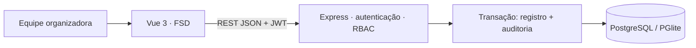
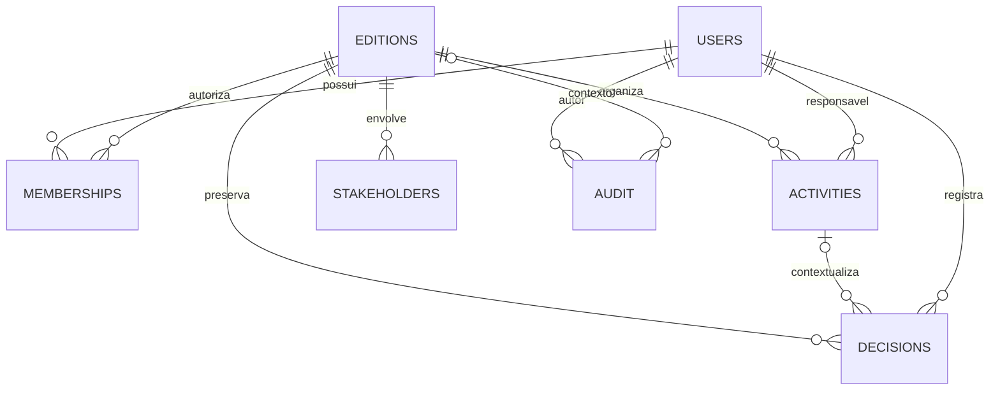

# Arquitetura e decisões

Problema priorizado: perda de contexto e responsabilidades quando informações administrativas ficam dispersas e a equipe muda. Público: administração institucional, coordenação de edição e colaboradores operacionais. Hipótese: registros centralizados, autoria e consulta histórica reduzem dependência de pessoas específicas. O MVP demonstra o fluxo; não mede impacto real nem presume validação institucional.

REST usa prefixo `/api`. A identidade vem do JWT, mas papel e situação ativa vêm do banco em cada requisição. Administração acessa todas as edições; demais perfis exigem membership. Toda gravação em uma edição verifica bloqueio de arquivamento no servidor. Novas atribuições exigem responsável ativo e com acesso à edição.

- `editions`: referência administrativa compartilhável, situação, data, local e resumo.
- `memberships`: vínculo explícito por usuário e edição; perfil global está em users.
- `activities`: título, descrição, responsável único, prazo, prioridade, situação e versão.
- `decisions`: título, justificativa, autor, data e vínculo opcional com atividade. Somente inclusão.
- `stakeholders`: nome e função por edição; não equivale a usuário do sistema.
- `audit`: autor, instante, entidade, identificador, ação e JSON antes/depois. Mudanças em contas têm contexto de edição nulo e são visíveis na auditoria administrativa.

IDs de domínio usam UUID para novos registros; seed usa IDs legíveis. Auditoria usa sequência bigserial. Chaves estrangeiras preservam referências. Todos os dados do seed são fictícios. O log registra contas sem senha/hash. Respostas de atividades não carregam dados privados da conta além da identificação do responsável.

## Escolhas e trade-offs

Vue 3 + TypeScript com FSD separa composição de páginas, fluxos de usuário, entidades e infraestrutura. O shell é widget; o formulário de atividade e a sessão são features reutilizáveis. Recursos menores permanecem nas páginas para evitar abstrações vazias. Vite faz proxy em desenvolvimento; no build, Express serve o frontend na mesma origem.

PostgreSQL atende relações, integridade e auditoria. PGlite executa o motor PostgreSQL em um único processo no modo de demonstração, com armazenamento local; o adaptador `pg` atende PostgreSQL externo. Ambos usam consultas parametrizadas e a mesma migração. Não foram adicionados Redis, microsserviços nem agentes autônomos: os “agentes” deste recorte são os atores humanos e suas responsabilidades.

Migração e seed executam na inicialização de uma instância. Para produção com múltiplas réplicas, mover migrações para um job exclusivo, adicionar bloqueio de migração e credenciais separadas. Atividades usam versão otimista mais bloqueio de linha; arquivamento bloqueia a linha da edição dentro da transação.

## Fronteiras e interoperabilidade futura

| Informação                                  | Fonte de verdade proposta | Consumo futuro                    | Regra                                     |
| ------------------------------------------- | ------------------------- | --------------------------------- | ----------------------------------------- |
| edition.id e metadados gerais               | Gestão do Evento          | Competições e histórico público   | Contrato versionado e validação por campo |
| Atividades, contatos e auditoria            | Gestão do Evento          | Equipe administrativa autorizada  | Não publicar automaticamente              |
| Modalidades, equipes, disputas e resultados | Gestão das Competições    | Outros domínios conforme contrato | Não modelados neste MVP                   |
| Conteúdo público e memória educativa        | Histórico Público         | Portal público                    | Publicação validada pela instituição      |

Não existe endpoint público nem compartilhamento entre equipes nesta entrega. Uma futura API de integração deverá usar credencial de serviço, escopo mínimo e aprovação institucional dos campos publicados. Não reutilizar o endpoint administrativo como portal público.
